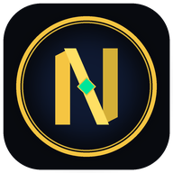

<p align="center">
  
</p>

<h1 align="center">🏛️ Nexora OmniWear Suite</h1>
<h3 align="center">Enterprise Smartwatch & Wearable Banking Pentest Framework</h3>

<p align="center">
  <em>A state-of-the-art, dual-device wearable banking lab engineered for security researchers, fintech auditors, and penetration testers to evaluate Wear OS and Apple watchOS attack surfaces against tier-1 digital banking standards.</em>
</p>

<p align="center">
  <!-- Release & Build Badges -->
  <a href="https://github.com/angganovryanputra/nexora-private-banking/releases/latest"></a>
  <a href="https://github.com/angganovryanputra/nexora-private-banking/actions/workflows/release.yml"></a>
  
  
</p>

<p align="center">
  <!-- Regulatory & Framework Badges -->
  
  
  
  
</p>

---

## 🔍 Overview: The Wearable Banking Attack Surface

Most financial institutions assume that smartwatch applications are merely passive screen mirrors of their companion mobile apps. In reality, modern smartwatch banking implements an autonomous client-side attack surface:

- **Unencrypted Local Key-Value Plists & SharedPreferences** (`UserDefaults` / Android Keystore bypasses).
- **Cleartext Transport Channels** (Raw BLE broadcasts and unencrypted `WCSession` dictionaries).
- **Unthrottled 4-Digit Ergonomic Quick-PINs** ($10^4$ combinations without hardware exponential backoff).
- **Contactless Dynamic SNAP QRIS Replay** (EMVCo payload generation lacking cryptographic timestamp validation).
- **High-Value ($50,000) Out-of-Band (OOB) Wire Transfer Hijacking** (Interactive notification approvals lacking biometric or Secure Enclave hardware signatures).
- **Emergency Card Kill-Switch & ATM Cardless Cash** (Wearable-originated transactional commands).
- **Optical PPG Sensor & Wrist-Off Lockout Evasion** (Client-side boolean state manipulation).

Relying solely on traditional smartphone penetration tests leaves up to **80% of the smartwatch banking attack surface unverified**.

**Nexora OmniWear** resolves this blind spot with a 100% air-gapped, dual-persona assessment environment featuring a hyper-realistic commercial banking frontend and a covert **Security Audit Mode** equipped with 14 active exploit vectors.

---

## 📦 Official Multi-Platform Releases (1-Click Download)

Pre-compiled, production-ready release packages are automatically compiled and published via our multi-platform CI/CD pipeline on [**GitHub Releases**](https://github.com/angganovryanputra/nexora-private-banking/releases/latest):

| Target Device | Package File | Compatibility & Architecture | Direct Download |
|---|---|---|---|
| ⌚ **Wear OS Watch** | `nexora-wear-release.apk` | Samsung Galaxy Watch, Pixel Watch, Wear OS 3+ (`arm64-v8a`, `x86_64`) | [📥 Download Wear APK](https://github.com/angganovryanputra/nexora-private-banking/releases/latest/download/nexora-wear-release.apk) |
| 📱 **Android Phone** | `nexora-companion-release.apk` | Android 10+ Physical Phone & Emulator | [📥 Download Companion APK](https://github.com/angganovryanputra/nexora-private-banking/releases/latest/download/nexora-companion-release.apk) |
| 🌐 **Universal Android** | `nexora-universal-release.apk` | Standalone hybrid binary for phone or watch | [📥 Download Universal APK](https://github.com/angganovryanputra/nexora-private-banking/releases/latest/download/nexora-universal-release.apk) |
| 🍏 **iPhone 11 (iOS)** | `nexora-ios-companion-release.ipa` | iPhone 11 / iOS 15.1+ (Sideload via Sideloadly / AltStore) | [🍏 Download iOS IPA](https://github.com/angganovryanputra/nexora-private-banking/releases/latest/download/nexora-ios-companion-release.ipa) |
| ⌚ **Apple Watch** | `Nexora-watchOS-Bundle.zip` | Apple Watch Series 9, Ultra (watchOS 9.0+) Native SwiftUI | [⌚ Download watchOS Bundle](https://github.com/angganovryanputra/nexora-private-banking/releases/latest/download/Nexora-watchOS-Bundle.zip) |
| 🔒 **Integrity Checksums** | `SHA256SUMS.txt` | Cryptographic SHA-256 Checksums for forensic audit verification | [🔒 Download SHA256SUMS](https://github.com/angganovryanputra/nexora-private-banking/releases/latest/download/SHA256SUMS.txt) |

*(All packages are signed and ready for immediate deployment).*

---

## 🧭 Dedicated Environment Research Guides

Documentation is cleanly separated into two standalone, end-to-end research manuals:

<table width="100%">
  <tr>
    <td width="50%" align="center" valign="top">
      <h3>🤖 Environment 1: Android & Wear OS</h3>
      <p><em>Comprehensive testing lab for Wear OS smartwatches (Samsung Galaxy Watch, Google Pixel Watch) and Android companion phones.</em></p>
      <ul align="left">
        <li>Dual AVD Emulator setup (Wear OS 480x480 & Smartphone)</li>
        <li>Physical smartwatch pairing via ADB over Wi-Fi</li>
        <li>Authentic banking user flows & Cardless ATM Cash</li>
        <li>8 Master Pentest Writeups with code root causes & PoC commands</li>
        <li>ADB & Frida script cheatsheet</li>
      </ul>
      <a href="docs/ANDROID_WEAROS_GUIDE.md"><strong>👉 Read Android & Wear OS Lab Guide</strong></a>
    </td>
    <td width="50%" align="center" valign="top">
      <h3>🍏 Environment 2: Apple iOS & watchOS</h3>
      <p><em>Comprehensive testing lab for Apple Watch (Series 9, Ultra, watchOS 9+) and iPhone 11 physical device / iOS Simulator.</em></p>
      <ul align="left">
        <li>Xcode 15+ Paired Simulator setup (macOS Intel & Apple Silicon)</li>
        <li>Physical iPhone 11 sideloading via Sideloadly / AltStore</li>
        <li>Native SwiftUI Watch App walkthrough with WCSession sync</li>
        <li>8 Master Pentest Writeups with Objective-C / Swift memory hooks</li>
        <li>watchOS Frida & Cycript cheatsheet</li>
      </ul>
      <a href="docs/APPLE_WATCHOS_GUIDE.md"><strong>👉 Read Apple watchOS & iOS Lab Guide</strong></a>
    </td>
  </tr>
</table>

---

## 🏛️ System Architecture & Wireless Relay

All event transmissions, wireless balance synchronizations, and 2FA authorization flows execute through a 100% offline (air-gapped) local Python relay:

```
┌─────────────────────────────────────────────────────────────┐
│                 Researcher Laptop / Local Host              │
│       Nexora Air-Gapped Core Banking Relay (0.0.0.0:5000)   │
└──────────────────────────────┬──────────────────────────────┘
                               │ Local HTTP REST / Wi-Fi LAN
                               ▼
┌─────────────────────────────────────────────────────────────┐
│             Smartphone Companion (Android / iPhone 11)      │
│  - Nexora Bank React Native Companion                       │
│  - Native Bridge: BluetoothSync (Android) / WatchBridge (iOS)│
│  - Attacker & Orchestration Console                         │
└──────────────────────────────┬──────────────────────────────┘
                               │ Bluetooth LE / Apple WCSession
                               ▼
┌─────────────────────────────────────────────────────────────┐
│         Smartwatch Target (Wear OS / Apple Watch Series 9)   │
│  - AMOLED 480x480 UI (Wear OS) / Native SwiftUI (watchOS)   │
│  - 3x4 Quick-PIN Pad & Glanceable Platinum Balance          │
│  - Bank Indonesia SNAP QRIS Merchant Generator              │
│  - ATM Cardless Cash 6-Digit Dynamic Code Generator         │
│  - Emergency Card Freeze / Unfreeze Kill-Switch             │
│  - Optical PPG Heart Rate Biometrics & Wrist-Off Lockout    │
│  - High-Value ($50,000) Out-of-Band 2FA Wire Modal          │
└─────────────────────────────────────────────────────────────┘
```

---

## 🚀 Quick Start (3-Minute Setup)

### 1. Launch the Air-Gapped Local Backend
Ensure Python 3.9+ is installed, then launch the local server:
```bash
git clone https://github.com/angganovryanputra/nexora-private-banking.git
cd nexora-private-banking
python backend/server.py
```
> Server runs on `http://0.0.0.0:5000` (`http://127.0.0.1:5000` or `http://10.0.2.2:5000` for Android Emulator).

### 2. Install Client Applications
- **For Android / Wear OS**: Install APKs via ADB:
  ```bash
  adb -s <PHONE_ID> install nexora-companion-release.apk
  adb -s <WATCH_ID> install nexora-wear-release.apk
  ```
- **For iOS / Apple Watch**: Open `ios/VulnerableBankApp.xcworkspace` in Xcode or sideload `nexora-ios-companion-release.ipa` via Sideloadly / AltStore.

### 3. Login with Seed Credentials
- **Username**: `admin`
- **Password**: `admin123`
- **Account Number**: `ADMIN001`
- **Smartwatch Quick-PIN**: `1234`

### 4. Accessing Security Audit Mode
Tap the **Security Shield** icon on the Dashboard or tap the **App Version** 5 times in **Profile** to uncover the **Security Research Lab** and live exploit triggers!

---

## 🛡️ Regulatory Compliance Scorecard

| Standard & Regulation | Target Mandate | Observed Vulnerability | Severity |
|---|---|---|---|
| **OJK POJK 11/POJK.03/2022** | Pasal 25 & 38 (Customer Data Protection) | Sensitive JWT auth tokens, Quick-PINs, and balances stored in plaintext SharedPreferences / UserDefaults Plists. | **HIGH (7.8)** |
| **OJK POJK 11/POJK.03/2022** | Pasal 31 & 42 (Cyber Resilience & MFA) | $50,000 high-value wire transfers approved without biometric authentication or Secure Enclave cryptographic proof. | **CRITICAL (8.7)** |
| **Bank Indonesia SNAP QRIS** | PADG No. 24/1/PADG/2022 (Dynamic QRIS) | QRIS payment payload lacks cryptographic nonce, timestamp freshness, and server signature, enabling indefinite replay attacks. | **HIGH (7.7)** |
| **PCI-DSS v4.0** | Requirement 3.4 & 4.1 (Cardholder Data) | Plaintext short-range transmission of financial commands over Bluetooth LE and WCSession without application-layer AES-GCM. | **CRITICAL (8.8)** |
| **OWASP Mobile Top 10 (2024)** | M1, M3, M5, M8, M9 | 14 active attack vectors documented with verified exploit chains across wearable and companion layers. | **CRITICAL** |

---

## 📜 License
Distributed under the **MIT License**. Engineered for educational security research, ethical penetration testing, and regulatory compliance benchmarking.
